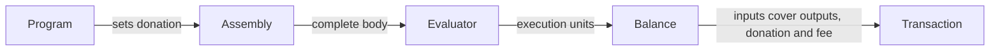

# Treasury donation in transaction building

As a transaction author, I want to donate a chosen amount to the Cardano
treasury while funding the fee and change correctly, so the ledger receives
exactly the allocation I requested.

## Behavior

A donation instruction sets the transaction body's treasury donation. The
last instruction wins; an omitted instruction means zero. The evaluator sees
the donation in every transaction it evaluates. Balancing subtracts the
donation before allocating change and refuses insufficient funds. The fee
covers the final transaction size. Programs without the instruction preserve
their existing serialized transaction bytes.

The donation is a body field, funded from ordinary inputs. It is not a
payment output or an additional fee.

## Required checks

- A nonzero donation balances, and inputs equal outputs plus donation plus fee.
- Fee estimation covers the final body, beside a zero-donation control.
- Donation is visible during evaluation and preserved by the returned body.
- Too little funding is refused beside sufficient funding.
- Omitting the instruction and explicitly setting zero produce identical bytes.

The checks run offline. They establish transaction construction, not submission
or inclusion on a network.
